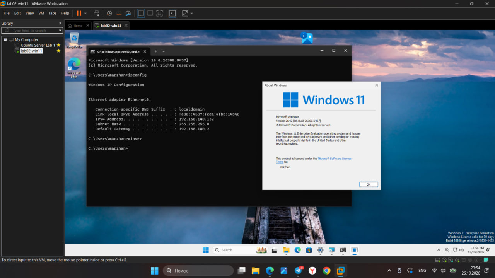

# Lab 02: A Windows guest, and a network between them

---

## What I did

1. **Provisioned Windows 11 Guest VM:**
   * Configured VM `lab02-win11` with 2 vCPUs, 4096 MB RAM, 64 GB NVMe virtual disk.
   * Deployed Windows 11 Enterprise Evaluation (Build 26100, 24H2) using the classic setup engine and isolated local ISO.
   * Installed VMware Tools for display auto-fitting and driver optimization.

2. **Configured Isolated NAT Subnet:**
   * Configured both `lab02-win11` and `Ubuntu Server Lab 1` virtual network adapters to **NAT** (`VMnet8`, `192.168.140.0/24`).

3. **Configured Inbound Firewall Rule on Windows:**
   * Enabled ICMP echo requests through Windows Defender Firewall without disabling protection:
     ```cmd
     netsh advfirewall firewall add rule name="ICMP Allow incoming V4 echo" protocol=icmpv4:8,any dir=in action=allow
     ```

4. **Verified Bidirectional Connectivity:**
   * Exported Windows IP configuration to evidence:
     ```cmd
     ipconfig /all
     ```
   * Tested ICMP connectivity from Windows to Linux:
     ```cmd
     ping 192.168.140.131
     ```
   * Tested ICMP connectivity from Linux to Windows:
     ```bash
     ping -c 4 192.168.140.132
     ```

5. **Executed Host Memory Overcommitment Experiment:**
   * Recorded baseline physical RAM consumption before launching virtual environments.
   * Increased memory allocations on both guests to exceed physical host limits (8 GB host vs. combined VM load).
   * Monitored host behavior under memory saturation via Task Manager.

---

## Result

### 1. Network Topology & Subnet Diagram
```text
+-------------------------------------------------------------+
| Host Machine (VMware Workstation NAT Gateway: 192.168.140.2)|
+-------------------------------------------------------------+
               |                               |
               v                               v
+-------------------------------+ +---------------------------+
| Linux VM (Ubuntu Server CLI)  | | Windows 11 Enterprise VM  |
| IP: 192.168.140.131           |<-> IP: 192.168.140.132      |
+-------------------------------+ +---------------------------+
```

* **Network Mode Rationale:** NAT mode was chosen instead of Bridged because campus and institutional Wi-Fi networks enforce strict MAC address filtering on physical access points. A bridged adapter requests a distinct physical MAC, causing silent packet drops by upstream switches. NAT transparently shares the host MAC and manages internal guest routing.
* **Firewall Verdict:** Standard Windows installations silently discard ICMP packets. An explicit rule was added via `netsh` allowing ICMPv4 Type 8 traffic, maintaining security baseline while restoring diagnostic reachability.

### 2. Host Memory Overcommitment Analysis
* **Host RAM before starting VM:** 7.0 GB / 7.7 GB utilized (91%), commit limit 11.5 / 21.2 GB.
* **Host RAM during concurrent execution:** 7.3 GB / 7.7 GB utilized (95%), total committed allocation surged to 18.2 GB / 21.9 GB.
* **Host Reaction:** The host operating system prevented an out-of-memory kernel panic by aggressively paging inactive host processes to disk (`C:\pagefile.sys`), keeping physical utilization pegged at ~95% while swap activity spiked.

### 3. System Verification


---

## What did not work the first time

1. **Installation Crash at 76% (Error 0x80070570):**
   * **Symptom:** The Windows installation repeatedly aborted at exactly 76% with error `0x80070570` ("Windows cannot install required files").
   * **Root Cause:** Direct browser downloads over an unstable Wi-Fi connection corrupted internal blocks of the 8 GB `install.wim` image. Furthermore, storing the file inside an active OneDrive sync directory (`C:\Users\...\OneDrive\Рабочий стол\`) created filesystem lock contention during high-throughput decompression.
   * **Resolution:** The ISO was relocated to a clean local root directory (`C:\iso\win11.iso`), the virtual NIC was disconnected during setup, and an intact ISO was verified and transferred via physical USB flash drive (`Диск 1 (D:) Сменный (USB)`). Setup was executed using the "Previous Version of Setup" engine.

2. **Initial Inbound Ping Rejection:**
   * **Symptom:** Pinging from Ubuntu (`192.168.140.131`) to Windows (`192.168.140.132`) returned 100% packet loss despite working outbound internet access.
   * **Root Cause:** Windows Defender Firewall Public/Private profile blocks unsolicited ICMPv4 Echo Requests by default.
   * **Resolution:** Executed `netsh advfirewall` to add an inbound permit rule for `icmpv4:8` rather than dangerously turning the entire firewall off.

---

## Evidence

* [evidence/ipconfig-windows.txt](evidence/ipconfig-windows.txt) — Proves Windows 11 guest network parameters (IPv4 `192.168.140.132`, Gateway `192.168.140.2`).
* [evidence/ip-addr-linux.txt](evidence/ip-addr-linux.txt) — Proves Linux guest network configuration (IPv4 `192.168.140.131` on `ens33`).
* [evidence/ping-both-ways.txt](evidence/ping-both-ways.txt) — Proves bidirectional ICMP reachability (Windows to Linux and Linux to Windows) with 0% packet loss.
* [evidence/host-memory-before.png](evidence/host-memory-before.png) — Proves host memory allocation prior to running virtual machines (7.0 GB / 91%).
* [evidence/host-memory-after.png](evidence/host-memory-after.png) — Proves host memory saturation and commit footprint (7.3 GB / 95%, 18.2 GB committed) during hypervisor execution.
* [evidence/win11-verification.png](evidence/win11-verification.png) — Proves successful guest provisioning with user `marzhan`, active NAT adapter, and VMware Tools.
* [evidence/error-0x80070570.png](evidence/error-0x80070570.png) — Proves the encountered decompression failure at 76% for the troubleshooting record.
