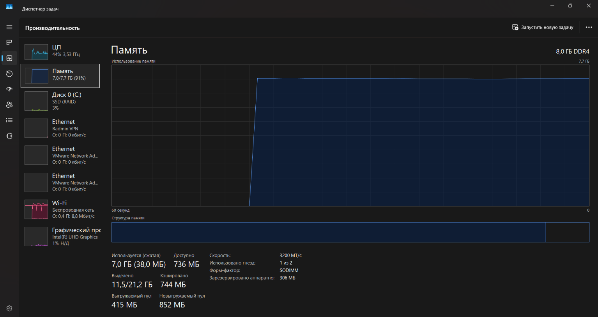
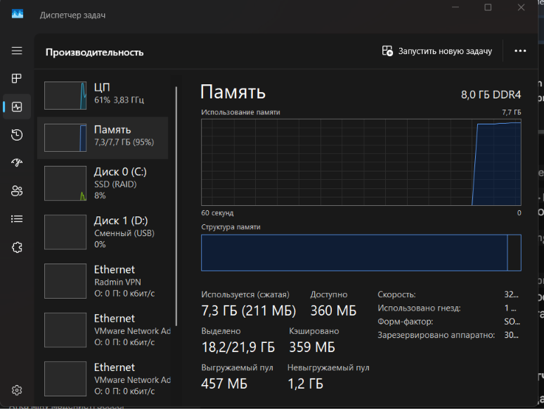
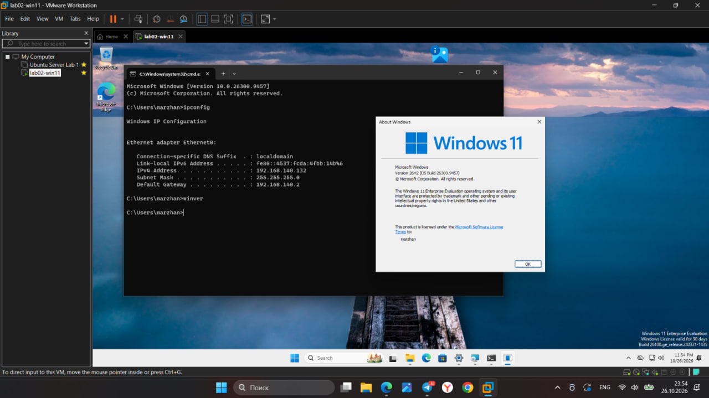
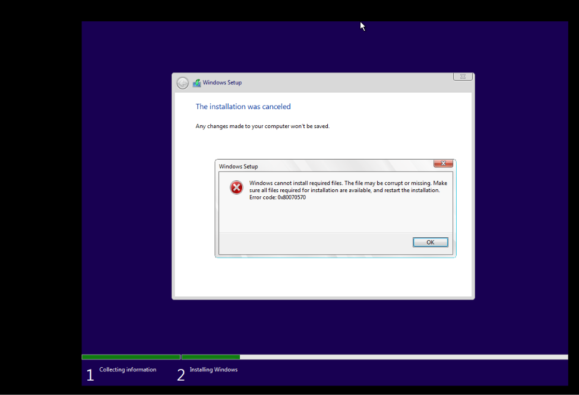

# Lab 02: Windows 11 Virtual Machine Deployment

## 1. Virtual Machine Specifications
* **VM Name:** `lab02-win11`
* **vCPU:** 2
* **RAM:** 4096 MB (4.0 GB)
* **Storage:** 64.0 GB NVMe (Single file, thin provisioned)
* **Network Mode:** NAT (VMnet8)
* **OS Edition:** Windows 11 Enterprise Evaluation (Build 26100, Version 24H2)

---

## 2. Host Memory Impact Analysis
To evaluate the hypervisor memory footprint on the host system (8.0 GB physical RAM), measurements were captured via Task Manager:

* **Host RAM before starting the VM:** 7.0 GB / 7.7 GB utilized (91%)  
  

* **Host RAM after VM boot & runtime:** 7.3 GB / 7.7 GB utilized (95%, committed 18.2 GB)  
  

---

## 3. Network Configuration & Verification
* **Windows VM IPv4:** `192.168.140.132` (verified via `ipconfig`)
* **Linux Server VM IPv4 (Lab 01):** `192.168.140.131` (from `evidence/ip-addr-linux.txt`)
* **Subnet:** `192.168.140.0/24` (Default Gateway: `192.168.140.2`)
* **User & License Verification:** Licensed to `marzhan` (verified via `winver`)

---

## 4. What Did Not Work the First Time :( (Troubleshooting)

### Problem Description
The deployment failed repeatedly over the course of three days during the "Getting files ready for installation" stage, consistently crashing at exactly 76%:
* Under the default setup interface, the installer terminated silently without a diagnostic code.
* Switching to the classic setup engine revealed the exact fatal error: **`0x80070570`** (*"Windows cannot install required files. The file may be corrupt or missing"*).

### Root Cause Analysis & Diagnostic Process
1. **Unstable Network & Incomplete WIM Container:** Due to high packet loss and connection drops on the local Wi-Fi, direct browser downloads of the massive 7–8 GB Enterprise ISO repeatedly dropped or silently corrupted blocks inside the compressed `install.wim` image. While the ISO file seemed complete on the surface, decompression consistently aborted at the corrupted 76% offset.
2. **Path & Synchronization Conflicts:** The initial ISO was placed under an active Microsoft OneDrive synchronization directory containing Cyrillic characters (`C:\Users\Админ\OneDrive\Рабочий стол\iso\`). During heavy I/O operations at 76%, OneDrive attempted background file indexing, locking access to the virtual CD/DVD device.
3. **VMware Setup Wizard Conflicts:** The experimental Windows 11 setup wizard frequently stalled when attempting simultaneous online updates and unattend checks over an active virtual network adapter.

### Resolution Steps
1. **Path Normalization:** Created a clean root directory without Cyrillic letters or cloud synchronization hooks (`C:\iso\win11.iso`).
2. **Network Isolation:** Temporarily disabled the virtual network adapter (`Connected` and `Connect at power on` unchecked) to prevent the setup wizard from attempting background patch downloads.
3. **Engine Fallback:** Utilized the built-in **"Previous Version of Setup"** link to run the stable, classic Windows setup engine.
4. **Physical Media Transfer:** Because local re-downloads over the unstable network continued to corrupt the 8 GB image, a verified, integral Windows 11 ISO was transferred offline via an external USB flash drive (visible as `Диск 1 (D:) Сменный (USB)` in the host hardware monitoring).
5. **Finalization:** Once installed from the verified media, the VM booted successfully, the virtual network adapter was restored, and VMware Tools were installed for full display scaling.
