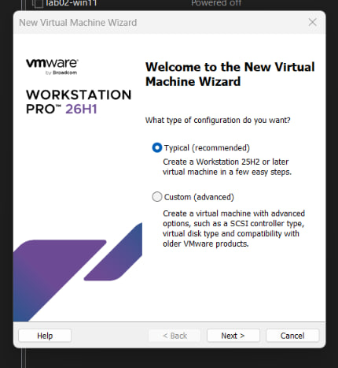

# Virtual Machine Build Manual: Ubuntu Server Test Environment

**Target Audience:** Aigerim T. (Office Management / Internal IT Support)  
**Author:** Marzhan Amantay  
**Purpose:** Step-by-step reproducible guide for building an isolated, non-destructive test virtual machine from scratch using VMware Workstation Pro.  
**Hardware Baseline:** Windows 11 host with 8 GB physical RAM and 256 GB SSD storage.

---

## Step 1. Virtual Machine Creation Wizard

Launch VMware Workstation Pro, click **File** $\rightarrow$ **New Virtual Machine** (or press `Ctrl + N`), and select **Typical (recommended)**.



**Why Typical and not Custom:** The *Typical* wizard automatically configures verified motherboard chipsets, SCSI controller buses, and hypervisor clocks optimized for modern operating systems. Choosing *Custom* presents advanced hardware switches that introduce bus driver incompatibilities if selected without kernel-level knowledge.

> **Check:** The wizard advances to the installation source screen without prompting for low-level SCSI controller types.

---

## Step 2. Guest Operating System & Media Selection

Choose **I will install the operating system later**, click **Next**, select **Linux** with version **Ubuntu 64-bit**, and assign a clean name (e.g., `dev-testbox`).

**Why install later and not immediately mount the ISO:** If you attach the ISO installer on this screen, VMware engages an automated *Easy Install* routine. *Easy Install* bypasses essential system configuration prompts, provisions default system users, and frequently misconfigures network hostnames and OpenSSH initialization. Deferring the ISO ensures a clean, manual installation under our exact control.

> **Check:** The summary page indicates guest OS `Ubuntu 64-bit` with an empty virtual optical drive.

---

## Step 3. Disk Sizing and Provisioning Strategy

Set the maximum disk size to **20.0 GB** and select **Split virtual disk into multiple files**. Ensure the checkbox **Allocate all disk space now** is strictly unchecked.


**Why 20 GB and not preallocated (Thin Provisioning):** Preallocating disk space immediately claims 20 GB of unshrinkable physical storage from our 256 GB host SSD. Leaving it non-preallocated enables *Thin Provisioning*: the initial guest occupies less than 1.5 GB physically, dynamically expanding only as the developer writes binaries and data. Splitting the disk keeps individual virtual disk extents small, preventing filesystem corruption during backups.

> **Check:** In VM Settings under Hard Disk, verify that *Disk space is not preallocated* is displayed and initial physical size is below 1 GB.

---

## Step 4. Hardware Sizing & ISO Attachment

Click **Customize Hardware...** on the final wizard screen. Allocate **2048 MB (2 GB)** of RAM and **1 Processor / 2 Cores**. Select **CD/DVD (SATA)**, choose **Use ISO image file**, and browse to your downloaded `ubuntu-server-live-installer.iso`.

**Why 2 GB RAM and 2 vCPUs:** Our host laptop possesses 8 GB of physical memory and 2 physical CPU cores (4 logical threads). Allocating 2 GB gives the Linux server adequate headroom to run compilers, runtimes, and background daemons without consuming the memory required by the Windows host OS (which requires ~4 GB for stable operation).

> **Check:** In the Hardware list, *Memory* displays 2 GB and *CD/DVD* points directly to the valid ISO file path.

---

## Step 5. Network Configuration

In the VM Settings window, highlight **Network Adapter** and choose **NAT: Used to share the host's IP address**.


**Why NAT and not Bridged:** The Innotech teaching network filters connections by physical hardware MAC address. A bridged adapter issues the virtual guest its own unique MAC address, which the campus access points reject. Behind NAT, the hypervisor acts as a private router: the guest accesses external package repositories using the host's authenticated IP and MAC address, eliminating connection blocking.

> **Check:** Power on the VM, complete OS installation, and run `ip addr` in the guest terminal. You should see an IP address in the private `192.168.x.x` subnet, distinct from the host's physical network.

---

## Step 6. Base OS Installation & OpenSSH Service

Power on the virtual machine and proceed through the interactive Ubuntu installer:
1. Choose **English** as the primary language.
2. Accept automatic DHCP network addressing on `ens33`.
3. Create a developer user profile (e.g., username `developer` and a secure temporary password).
4. On the **SSH Setup** screen, ensure you press Space to check **[X] Install OpenSSH server**.
5. Complete installation, reboot, and log in to the terminal prompt.

**Why OpenSSH must be enabled:** A developer test machine requires headless terminal access over the local network via terminal emulators (PowerShell, Windows Terminal, VS Code Remote). Without OpenSSH, all interaction is trapped inside the restricted hypervisor graphical window.

> **Check:** Run `systemctl status ssh` inside the guest. The output must state `active (running)`.

---

## Step 7. Verification Commands

To confirm the guest system kernel and network reachability, run the standard diagnostics:

1. Kernel validation:
   ```bash
   uname -a
   ```
2. Inter-guest reachability test:
   ```bash
   ping -c 4 <windows-vm-ip>
   ```

> **Check:** `uname -a` displays a functional 64-bit Linux kernel, and ping packets report `0% packet loss`.

---

## Step 8. Snapshot Hygiene

Once the system is fully booted, updated, and validated, shut down the guest or leave it at the login prompt. In the VMware top menu, click **VM** $\rightarrow$ **Snapshot** $\rightarrow$ **Take Snapshot...**. Name it **clean-install** and enter description: `Clean installation baseline with OpenSSH enabled`.


**Why snapshots are mandatory:** Developers inevitably corrupt package trees, environment variables, or filesystem permissions while testing unverified code. The `clean-install` snapshot allows non-technical personnel to revert the VM to pristine factory state in 2 seconds via the Snapshot Manager without performing a 20-minute manual OS reinstall.

> **Check:** Open **VM $\rightarrow$ Snapshot $\rightarrow$ Snapshot Manager** (`Ctrl + M`) and verify that `clean-install` is listed with a timestamp and preview thumbnail.
